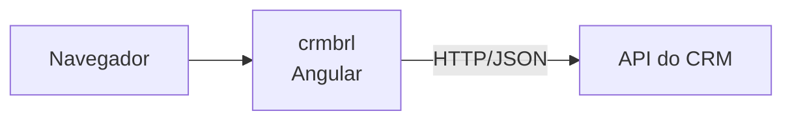

# Arquitetura — crmbrl

## Contexto

<!-- Escreva aqui, a mao, o porque das decisoes. Esta secao nunca e sobrescrita. -->

Interface web do CRM BRL. Aplicação Angular de página única que conversa com a
`crmbrl-api` por HTTP/JSON; não tem persistência nem regra de negócio própria.

Fluxo de inicialização hoje:

1. `src/main.ts` chama `bootstrapApplication(App, appConfig)` — sem `AppModule`, o
   bootstrap é standalone.
2. `src/app/app.config.ts` registra os providers da aplicação:
   `provideRouter(routes)` e `provideBrowserGlobalErrorListeners()`.
3. `src/app/app.ts` (`App`, seletor `app-root`) é a casca: renderiza apenas o
   `<router-outlet>`. O estado local usa `signal()`.
4. `src/app/app.routes.ts` ainda está com a lista de rotas vazia — nenhuma tela foi
   criada.

Em resumo: o projeto está no estado de scaffold do Angular CLI. As tabelas acima
refletem isso e vão se preencher conforme as telas forem entrando.

### Integração com a API

A `crmbrl-api` (NestJS) vive em um repositório separado, com ciclo de release
próprio. Não há pacote compartilhado nem tipo importado de um lado para o outro: o
contrato entre os dois é só o HTTP. Hoje a API expõe apenas `GET /`, e este projeto
ainda não faz nenhuma chamada — a tabela *Chamadas HTTP saindo deste projeto* está
vazia e passa a se preencher sozinha assim que o primeiro `HttpClient` entrar.

## Inventario tecnico

<!-- doc-updater:inicio — gerado automaticamente, nao edite a mao -->

> Atualizado por `tools/doc-updater` em 20/10/2026, 14:19 a partir do commit `e5e8dc8`.

### Resumo

| Item | Valor |
| --- | --- |
| Projeto | `crmbrl` |
| Versao | 0.0.0 |
| Framework | Angular ^22.2.0 |
| Papel | Front-end / SPA |
| Gerenciador de pacotes | npm |
| Arquivos versionaveis | 20 |
| Linhas de codigo | 422 |
| Arquivos de teste | 1 |
| Branch | dev |
| Commit documentado | `e5e8dc8` |
| Repositorio remoto | https://github.com/GitBRL/crmbrl.git |

### Topologia

### Estrutura de pastas

| Caminho | Arquivos |
| --- | --- |
| `(raiz)` | 10 |
| `src/app` | 6 |
| `src` | 3 |
| `public` | 1 |

### Componentes

| Componente | Seletor | Template | Arquivo |
| --- | --- | --- | --- |
| `App` | `app-root` | `./app.html` | `src/app/app.ts` |

### Rotas de navegacao

_Nada registrado ainda._

### Servicos injetaveis

_Nada registrado ainda._

### Chamadas HTTP saindo deste projeto

_Nada registrado ainda._

### Scripts disponiveis

| Comando | Executa |
| --- | --- |
| `npm run ng` | `ng` |
| `npm run start` | `ng serve` |
| `npm run build` | `ng build` |
| `npm run watch` | `ng build --watch --configuration development` |
| `npm run test` | `ng test` |
| `npm run docs` | `node tools/doc-updater/index.mjs` |

### Variaveis de ambiente usadas no codigo

_Nenhum._

### Dependencias de producao

| Pacote | Versao |
| --- | --- |
| `@angular/common` | ^22.2.0 |
| `@angular/compiler` | ^22.2.0 |
| `@angular/core` | ^22.2.0 |
| `@angular/forms` | ^22.2.0 |
| `@angular/platform-browser` | ^22.2.0 |
| `@angular/router` | ^22.2.0 |
| `rxjs` | ~7.8.0 |
| `tslib` | ^2.3.0 |

Dependencias de desenvolvimento (7)

| Pacote | Versao |
| --- | --- |
| `@angular/build` | ^22.2.2 |
| `@angular/cli` | ^22.2.2 |
| `@angular/compiler-cli` | ^22.2.0 |
| `jsdom` | ^30.0.0 |
| `prettier` | ^3.8.1 |
| `typescript` | ~6.0.2 |
| `vitest` | ^5.0.0 |

<!-- doc-updater:fim -->

## Decisoes de arquitetura

<!-- Registre aqui trade-offs, padroes adotados e o que foi descartado. -->

Decisões já visíveis no código (2026-10-20):

- **Componentes standalone, sem NgModule.** O bootstrap é via
  `bootstrapApplication`; não existe `AppModule` no front. Telas novas devem seguir
  o mesmo padrão e declarar suas dependências em `imports`.
- **Signals para estado de componente.** `App` já usa `signal()`. Preferir signals a
  campos mutáveis simples; reservar RxJS para o que é realmente assíncrono ou
  baseado em fluxo.
- **Builder `@angular/build:application`** (esbuild/Vite) em vez do webpack legado,
  e **Vitest** como runner de teste em vez de Karma/Jasmine.
- **SCSS** como linguagem de estilo, prefixo de seletor `app`.

Decisões que valem para os dois repositórios:

- **Repositórios separados**, sem monorepo e sem pacote compartilhado — o contrato
  com a `crmbrl-api` é só o HTTP.
- **Documentação versionada junto com o código**, em `docs/`, atualizada por
  [`tools/doc-updater`](../tools/doc-updater/README.md). Nada de documentação fora
  do repositório.
- **TypeScript 6** e **Prettier** nos dois lados.

Pendente de decisão — registrar aqui quando resolvido:

- Onde vive a URL base da API (arquivo de environment, token de injeção ou
  configuração em runtime). Ainda não há nenhuma chamada HTTP no código.
- Estratégia de autenticação e guarda de rota, e como o token chega até a API.
- Organização de pastas por feature (`src/app/features/...`) versus por tipo.
- Tratamento padrão de erro de HTTP (interceptor) — depende do formato de erro que
  a API definir.
