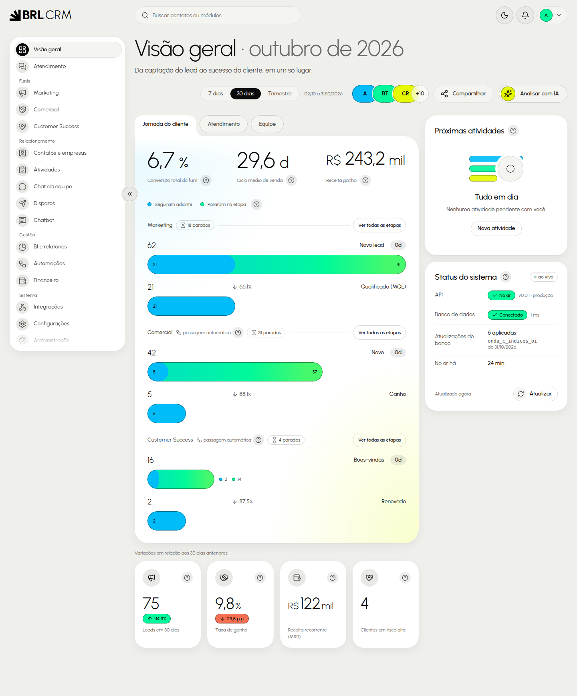
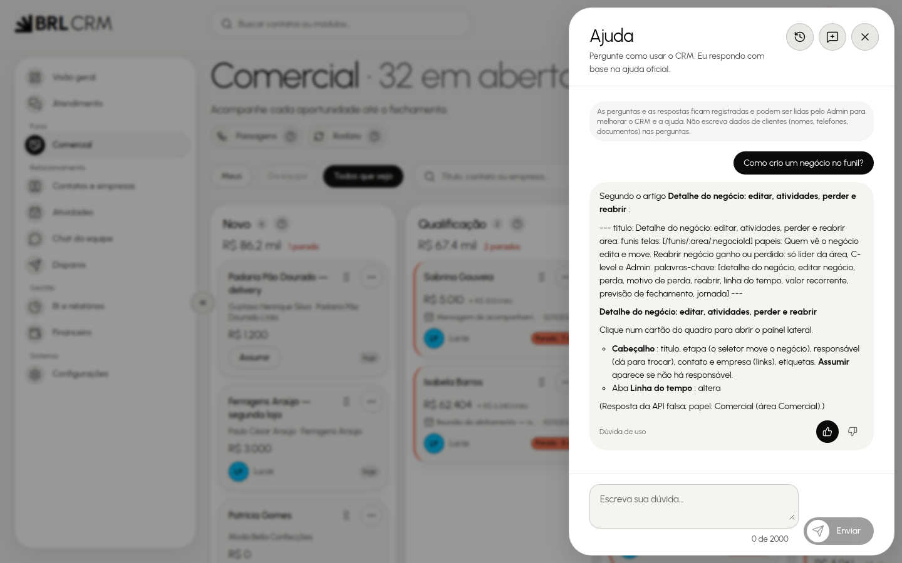
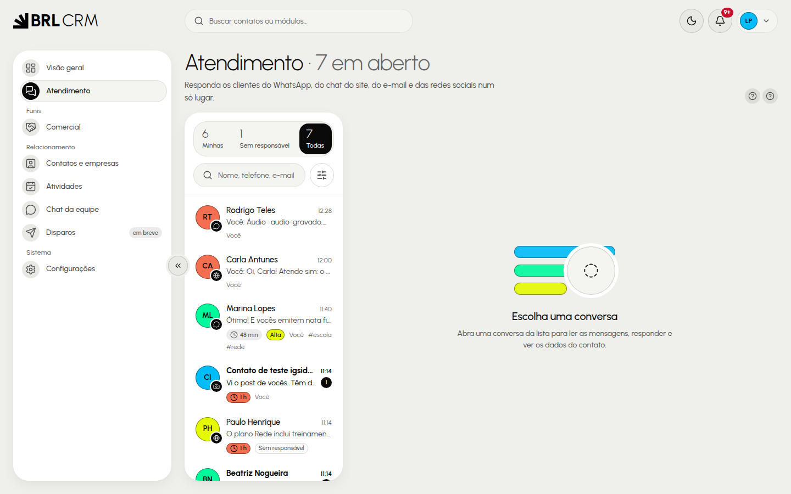
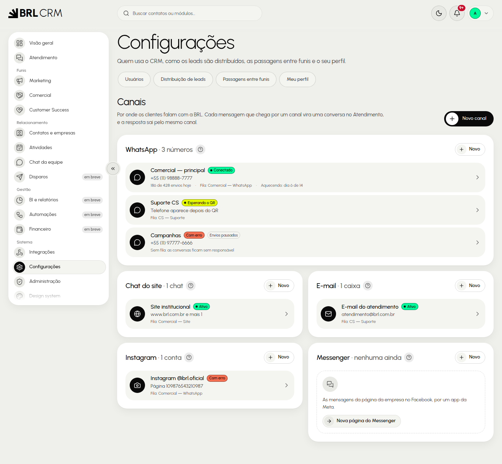
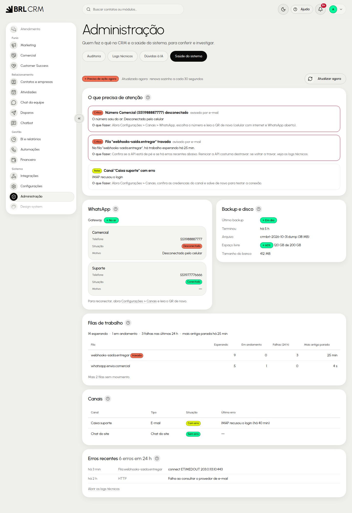
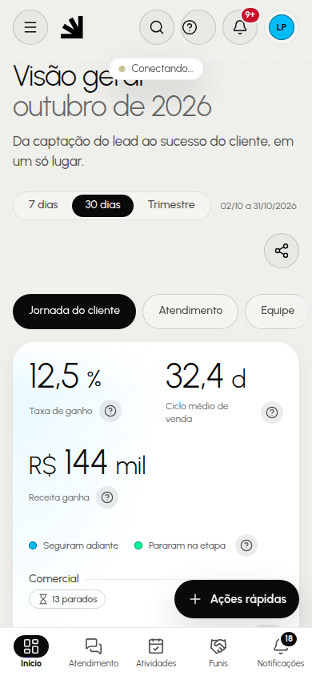

# Guia do usuário do BRL CRM

Este guia mostra, por área e por tarefa, como usar o CRM no dia a dia. Ele resume a base de conhecimento do
botão **Ajuda** (`crmbrl-api/docs/ajuda/*.md`, um artigo por tarefa): se algo aqui parecer diferente do que
você vê, o botão Ajuda e esses artigos têm o passo a passo completo. Nomes de botões estão como na tela.

**Como ler:** cada seção diz quem usa (papéis), as tarefas mais comuns e onde está o detalhe. O menu mostra só
o que o seu papel acessa; se um módulo não aparece, peça ao seu líder ou ao Admin.

## Sumário

1. [Primeiros passos](#1-primeiros-passos)
2. [Atendimento](#2-atendimento)
3. [Contatos e empresas](#3-contatos-e-empresas)
4. [Funis e negócios](#4-funis-e-negócios)
5. [Atividades](#5-atividades)
6. [Chat da equipe](#6-chat-da-equipe)
7. [Disparos e Chatbot](#7-disparos-e-chatbot)
8. [BI e relatórios](#8-bi-e-relatórios)
9. [Automações](#9-automações)
10. [Financeiro](#10-financeiro)
11. [Configurações (canais, usuários e papéis)](#11-configurações-canais-usuários-e-papéis)
12. [Administração e Saúde do sistema (Admin)](#12-administração-e-saúde-do-sistema-admin)
13. [No celular](#13-no-celular)
14. [O que o CRM não faz](#14-o-que-o-crm-não-faz)

## 1. Primeiros passos

**Entrar.** Abra o endereço do CRM, digite e-mail e senha e clique em **Entrar**. No primeiro acesso (ou com
senha temporária) o CRM leva você direto à troca de senha. Depois de 5 erros seguidos o e-mail fica bloqueado
por 15 minutos. Esqueceu a senha? **Esqueci minha senha** na tela de entrada; se o envio de e-mail não estiver
configurado, peça uma senha temporária ao Admin.

**Trocar a senha.** Avatar (canto superior direito) > **Trocar senha**: mínimo de 8 caracteres.

**Navegar.** O menu lateral agrupa Atendimento, Funis, Relacionamento, Gestão e Sistema. A busca da barra
superior leva a um módulo (se o termo não for um módulo, procura em Contatos e empresas). O **sino** mostra
menções, conversas transferidas, SLA estourado, atividades vencendo e negócios atribuídos; clique para ir ao
item e use **Marcar todas como lidas** para limpar.

**Visão geral.** A primeira tela resume o dia: jornada do cliente (métricas dos funis, com período de 7 dias, 30
dias ou trimestre), próximas atividades e o status do sistema.

**Pedir ajuda.**

Clique em **Ajuda** na barra superior de qualquer tela. O assistente responde dúvidas de uso levando em conta a
tela atual e o seu papel. Avalie a resposta (útil ou não). Se você pede algo que o CRM não tem, ou relata um
erro, ele oferece **Abrir chamado**, que só é enviado depois da sua confirmação. Atenção: as perguntas ficam
registradas e o Admin pode lê-las; não escreva senhas nem dados pessoais de clientes. O assistente explica o
caminho, mas não executa ações por você.

## 2. Atendimento

**Quem usa:** Admin e C-level (todas as conversas), líderes (as filas da área), membros de Comercial e CS (as
suas e as sem responsável da área). Marketing não acessa.

- **Ler a caixa de entrada.** As conversas dos cinco canais (WhatsApp, chat do site, e-mail, Instagram e
  Messenger) chegam numa lista só. A conversa vai para uma fila e, pelo rodízio, para quem está disponível.
- **Assumir, transferir, resolver, reabrir.** Abra a conversa e use os botões do topo. Transferir leva a
  conversa a outra pessoa ou fila; resolver pode pedir a nota de satisfação ao cliente (se ligada no canal).
- **Responder.** Escreva a mensagem, anexe arquivos ou use uma **resposta rápida**. A **nota interna** nunca
  chega ao cliente. No Instagram e no Messenger só dá para responder até 24 horas depois da última mensagem
  do cliente (regra da Meta).
- **Painel do contato.** Ao lado da conversa estão os dados do contato, os negócios e o histórico.
- **Configurar (líder, C-level, Admin).** Filas, prazos de SLA, horário de atendimento, satisfação e respostas
  rápidas ficam em Configurações; quando o prazo estoura, o líder é avisado pelo sino.

Detalhes: artigos `atendimento-*.md`.

## 3. Contatos e empresas

**Quem usa:** todos veem; editar: Admin e C-level (todos), líder (equipe), membro (os seus).

- **Buscar e filtrar** na lista; o detalhe do contato reúne dados, empresa, negócios (só das áreas que o seu papel
  acessa), atividades e a linha do tempo.
- **Criar contato ou empresa:** botão de novo cadastro. O CRM avisa de possíveis duplicados (telefone e e-mail).
- **Importar de planilha** (Admin, C-level e líderes): assistente em quatro passos (Arquivo, Colunas, Opções,
  Importação) com relatório em Excel.
- **Privacidade (LGPD):** marque **opt-out** ou **Não contatar por WhatsApp** quando o cliente pedir. Só o Admin
  anonimiza um contato, e isso não volta atrás.

Detalhes: `contatos-*.md`, `importacao-contatos.md`.

## 4. Funis e negócios

Há um funil por área: **Marketing**, **Comercial** e **Customer Success** (menu **Funis**).

- **Ler o quadro:** cada coluna é uma etapa; o cartão mostra contato, valor, responsável, tempo na etapa e
  próxima atividade. "Parado" em coral indica prazo da etapa vencido. Filtros: Meus, Da equipe, Todos.
- **Mover um negócio:** arraste o cartão (mouse, dedo ou teclado) ou use "⋯" > **Mover para…**. Na etapa de
  perda o CRM pede o motivo; na de ganho, o negócio segue para o Customer Success.
- **Assumir** um negócio sem responsável: botão **Assumir** no cartão.
- **Novo negócio** e **detalhe do negócio:** editar, registrar atividades, marcar como perdido e reabrir
  (reabrir é do líder da área, C-level e Admin).
- **Passagens e rodízio:** os negócios passam de funil automaticamente (Marketing > Comercial > CS) e os leads
  são distribuídos em rodízio. Configurar: Admin e C-level (passagens), mais líderes (rodízio).
- **Etapas do funil:** Admin, C-level e líder da área. Etapa com negócios não pode ser removida.

Detalhes: `funis-*.md`.

## 5. Atividades

Tipos: tarefa, ligação, reunião, e-mail, WhatsApp e nota.

1. Abra **Atividades**. No campo de criação rápida escreva, por exemplo, "Ligar para Maria amanhã às 10h".
2. Confira o "Entendido: …", vincule a contato, empresa ou negócio e clique em **Adicionar**.
3. Para concluir, marque a caixa; o aviso tem **Desfazer**.

A lista agrupa Atrasadas, Hoje, Próximos 7 dias, Mais tarde e Sem data. Você recebe lembretes antes do prazo.

## 6. Chat da equipe

Canais, grupos e conversas diretas entre colegas, com menções que chegam ao sino. Nada disso chega ao cliente, e
as conversas diretas só as duas pessoas leem (nem o Admin).

## 7. Disparos e Chatbot

**Disparos** (campanhas por WhatsApp e e-mail):

1. **Disparos** > **Nova campanha**. O assistente tem cinco passos (Público, Mensagem, Números e ritmo, Quando,
   Revisão) e salva rascunho a cada um.
2. Confira quantos contatos entram e quantos ficam de fora (opt-out, sem telefone, duplicados).
3. Envie um teste para o seu número e clique em **Iniciar**. Se a aprovação do líder estiver ligada, a campanha
   espera por ela.
4. Acompanhe, pause e veja resultados na tela da campanha. O envio é gradual, com intervalos, para proteger o
   número.

**Chatbot** (Admin, C-level e líderes): monte o fluxo, teste no simulador e publique. Os membros não acessam.

Detalhes: `disparos-*.md`, `configuracoes-disparos.md`, `chatbot-*.md`.

## 8. BI e relatórios

Cada papel vê as abas do seu painel (Marketing, Comercial, Sucesso do cliente, Atendimento e Financeiro para
Admin e C-level). Use os filtros de período e clique nos números para ver o detalhe; **Exportar** gera XLSX
ou CSV. O Admin tem ainda **Analisar com IA**, que lê só números agregados, sem dados pessoais.

## 9. Automações

Admin e C-level (todas) e líderes (da área) criam regras do tipo "quando acontecer X, faça Y". Sempre **teste**
antes de ligar. Os membros não acessam.

## 10. Financeiro

**Quem usa:** Admin, C-level e líder de CS (tudo); membro de CS (a própria carteira). Marketing não acessa;
Comercial só lê os contratos que ganhou.

- **Contratos:** criados a partir de um negócio ganho ou à mão; acompanhe vigência e valor.
- **Parcelas a receber:** filtre por situação e vencimento; clique na parcela > **Dar baixa** (data, valor e
  forma de pagamento). Dá para renegociar, cancelar, importar planilha e exportar.
- **Régua de cobrança:** executa os avisos de cobrança e registra o resultado das ligações. Dar baixa encerra a
  régua do título.
- **Indicadores:** MRR, inadimplência e churn.

O CRM não emite boleto, Pix nem nota fiscal e não se conecta a bancos: a baixa é manual ou por planilha.

## 11. Configurações (canais, usuários e papéis)

- **Meu perfil e Minha equipe:** dados pessoais; líderes e C-level veem a equipe.
- **Usuários (Admin):** **Convidar** envia um link por e-mail (vale 24 horas, uso único); editar papel e líder,
  reativar e definir senha temporária. **Desligar** um usuário pede para quem vai o trabalho dele.
- **Papéis e permissões:** o Admin muda os papéis; a tela de referência mostra o que cada um acessa.
- **Canais (Admin):**

- **WhatsApp:** Configurações > Canais > **Novo canal** > WhatsApp; leia o QR em "aparelhos conectados" do
  celular. O CRM controla limite diário, ritmo e aquecimento (14 dias) e pausa sozinho depois de falhas.
  Se o número desconectar, campanhas esperam e o Atendimento não envia até reconectar (leia o QR de novo).
- **Chat do site, e-mail, Instagram e Messenger:** cadastre o canal e, no site, cole o trecho de instalação.
- **Disparos (Admin e C-level):** limites e ritmo gerais.

## 12. Administração e Saúde do sistema (Admin)

**Auditoria** (Admin e C-level) mostra quem fez o quê e nunca se edita. **Logs técnicos** e **Dúvidas à IA**
(histórico de perguntas ao assistente, temas sem resposta e chamados) são só do Admin, assim como os webhooks de
entrada (captar leads) e de saída (avisar outros sistemas) em Integrações.

### Saúde do sistema

Administração > **Saúde do sistema** reúne, numa tela só, o que o Admin precisa conferir:

| Cartão                       | O que mostra                                                        | Quando agir                                              |
| ---------------------------- | ------------------------------------------------------------------- | -------------------------------------------------------- |
| **O que precisa de atenção** | Alertas, cada um com **O que fazer**                                | Sempre que houver um alerta crítico                      |
| **WhatsApp**                 | Gateway no ar ou fora, e a situação de cada número                  | Número desconectado ou banido; gateway fora              |
| **Backup e disco**           | Último backup, tamanho do arquivo, espaço livre e tamanho do banco  | Backup com falha ou atrasado; espaço livre abaixo de 15% |
| **Filas de trabalho**        | Trabalhos esperando, em andamento, com falha e o mais antigo parado | Fila marcada como "travada"                              |
| **Canais**                   | Último erro de e-mail, Instagram, Messenger e chat do site          | Erro recente de login ou de conexão                      |
| **Erros recentes**           | Os últimos erros dos logs técnicos                                  | Muitos erros em pouco tempo                              |

A tela se atualiza sozinha a cada 30 segundos (com a aba escondida ela não consulta);
**Atualizar agora** força a consulta.

**Alertas por e-mail.** Quando um número desconecta, uma fila trava, o gateway cai ou o backup falha ou atrasa,
os Admins recebem um e-mail (precisa do envio de e-mail configurado). O aviso sai uma vez e se repete como
lembrete a cada 6 horas enquanto o problema continuar; resolvido, o alerta some, e se voltar avisa de novo.

**O que fazer em cada alerta:**

- _Número desconectado:_ Configurações > Canais > WhatsApp, escolha o número e leia o QR de novo, com o celular
  conectado à internet. Número **banido** não volta: cadastre outro e redirecione as filas.
- _Gateway fora do ar:_ confira se o serviço está ligado (`docker compose ps`) e reinicie-o. As mensagens
  esperam na fila e saem quando ele volta.
- _Fila travada:_ há trabalho esperando há mais de 10 minutos (ou rodando há mais de 1 hora). Veja os erros
  recentes, abra os logs técnicos e reinicie a API se for preciso.
- _Backup falhou ou atrasado:_ veja o registro do serviço de backup, confira o espaço do volume e rode um backup
  manual depois de corrigir. "Nenhum backup registrado" é normal só em desenvolvimento.
- _Pouco espaço em disco:_ apague backups antigos, reduza a retenção ou aumente o disco.
- _Canal com erro:_ Configurações > Canais, confira as credenciais e salve de novo para testar.

## 13. No celular

O CRM funciona no navegador do celular e pode ser **instalado** como aplicativo: no Android, menu do navegador >
**Instalar aplicativo**; no iPhone, **Compartilhar** > **Adicionar à Tela de Início**. Nas telas pequenas
aparece uma barra de navegação inferior (Início, Atendimento, Atividades, Funis e Notificações), com ações
rápidas para responder, registrar atividade e mover negócio.

Sem internet, o CRM mostra o estado "sem conexão" (os dados nunca ficam guardados no aparelho). Quando sai uma
versão nova, aparece um aviso com o botão para atualizar. Nas preferências de notificação você escolhe quais avisos chegam
como notificação no aparelho (conversa atribuída, menção, atividade vencendo, SLA estourado, negócio atribuído,
parcela atrasada).

## 14. O que o CRM não faz

- Canais são só WhatsApp (conexão própria por QR, não a API oficial), chat do site, e-mail, Instagram e
  Messenger; não há SMS, Telegram nem ligação.
- Disparos são graduais, não envio instantâneo em massa; quem pediu opt-out não recebe.
- Não move negócio direto de um funil a outro (só pelas passagens) e não exclui os três funis.
- Sem bancos, boleto, Pix ou nota fiscal; sem agenda externa (Google, Outlook); integrações só por webhooks.
- A interface é só em português, e o app é o próprio navegador (não há loja de aplicativos).

Lista completa: `limites-o-que-o-crm-nao-faz.md`.
